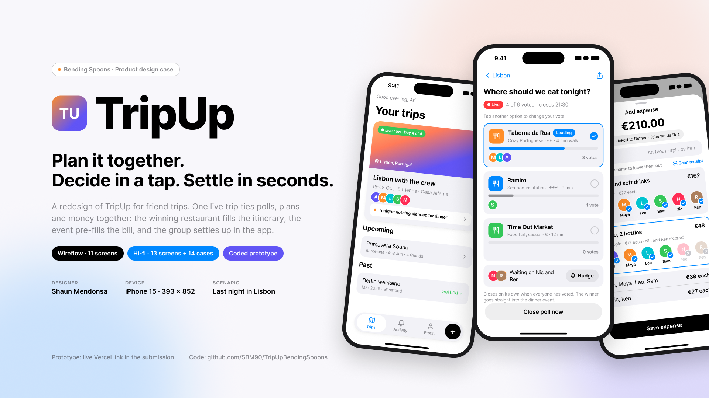
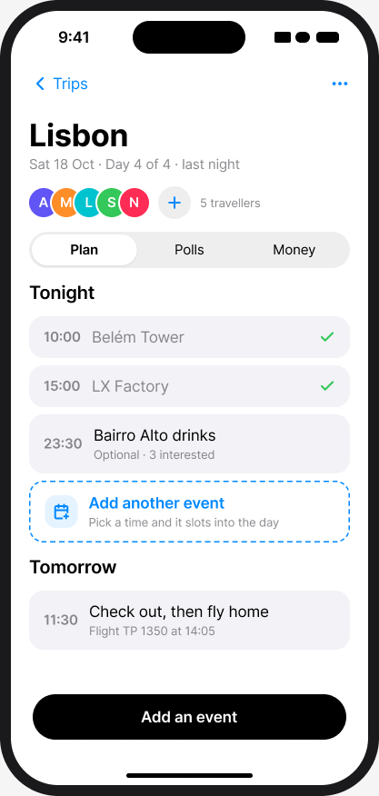
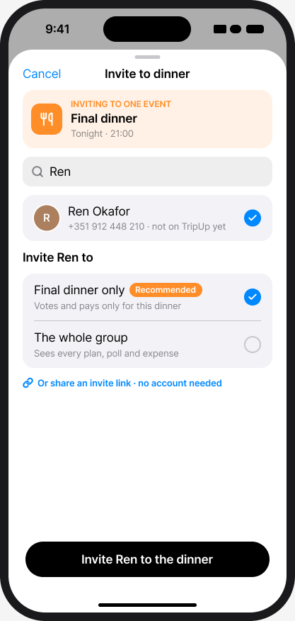
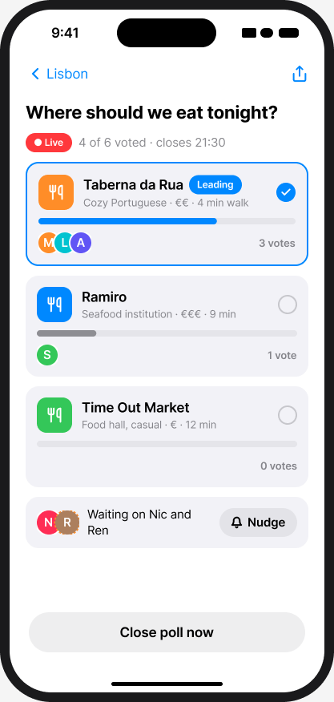
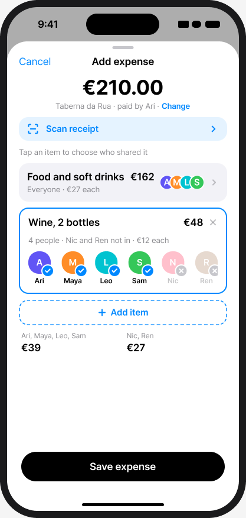
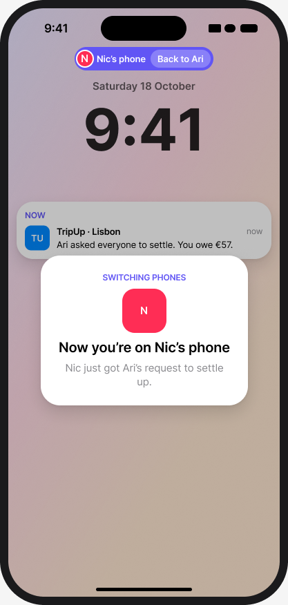
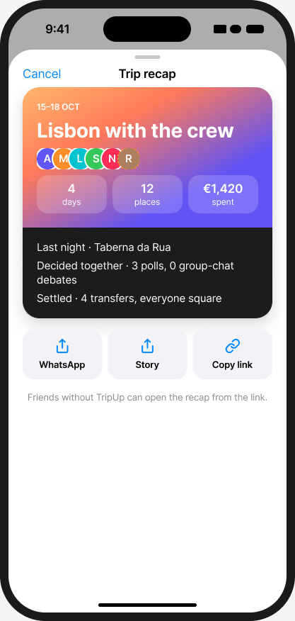
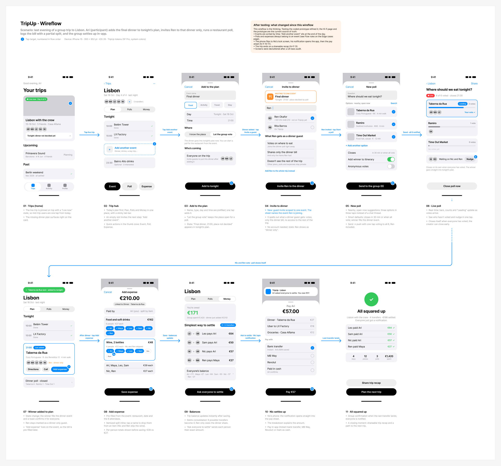
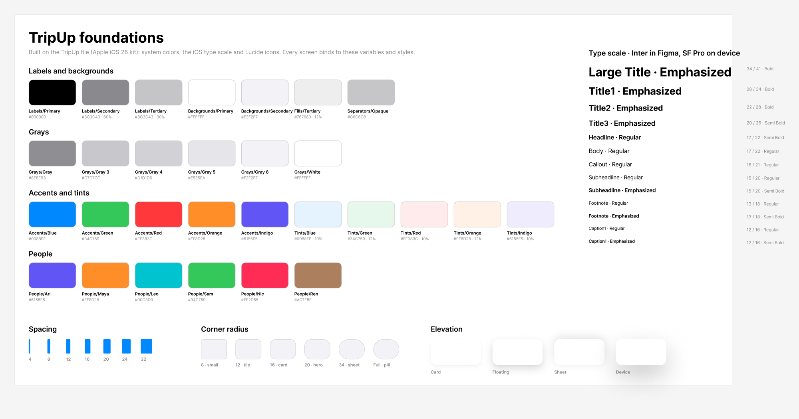

<div align="center">



# TripUp

**Plan it together. Decide in a tap. Settle in seconds.**

A coded prototype of a group-trip app, built for the Bending Spoons product design case.

[**Open the live prototype →**](https://trip-up-bending-spoons.vercel.app/)  
[Figma file](https://www.figma.com/design/3zLMaKlZCTYD9895yZke5B/BendingSpoonsCase) · [UX laws review](docs/ux-review.md) · [Design system source](https://www.figma.com/design/RXNQCsCdzVlZy5kg4dZI06/TripUp)

</div>

---

## The idea

Friend trips fall apart in the group chat. TripUp wins on speed against WhatsApp and on connection against Splitwise. **Every poll and every expense belongs to an event**, so a decision fills the plan, and the plan pre-fills the bill.

```
event  →  poll  →  plan  →  expense  →  settle up
```

## The scenario

It's the last evening of a trip to Lisbon. Ari, one of the participants, sorts out dinner and the bill:

1. **Adds the final dinner** to tonight's plan. It slots in by time, between LX Factory and Bairro Alto drinks.
2. **Invites Ren to that dinner only.** Ren joins by link without an account and can't see the rest of the trip.
3. **Runs a restaurant poll.** The other friends vote live, Ari nudges the last two, the poll closes itself, and the winner fills the dinner event.
4. **Logs the €210 bill** and taps Nic and Ren off the €48 wine.
5. **Settles up in the app.** Debts are simplified from 9 transfers to 4. The phone flips to Nic, who pays from a notification.
6. **All squared up**, with a shareable trip recap.

<div align="center">






<br />
<sub>Trip hub · Invite to dinner only · Live poll · Add expense · Phone flips to Nic · Trip recap</sub>
</div>

## Try it

Open **[trip-up-bending-spoons.vercel.app](https://trip-up-bending-spoons.vercel.app/)**.

- **On a phone:** the app fills the screen. In Safari, use Share → Add to Home Screen for the most app-like feel.
- **On a laptop:** you get an iPhone 15 frame at 393 × 852 pt, with a scenario checklist beside it and a Restart demo button.
- **No setup:** the other five friends respond on their own, so you can demo it alone.

The prototype is deliberately restrictive so every tester follows the intended flow. Choices outside the scenario (other days, other event types, deleting the dinner items) explain why they aren't available. Settling up waits until everyone who came is on the bill.

## Design highlights

| Decision | Why |
|---|---|
| Polls and expenses always belong to an event | The winner lands in the right time slot and the right people share the bill. "New poll" with no event offers "Add a new event first". |
| Guests scoped to one event | Ren votes and pays for the dinner only. Inviting someone after the bill exists flags it, and the expense opens with them tagged **New**. |
| Itemized split in one tap per person | Items collapse to a summary and expand to avatar toggles, so excluding two people from the wine is two taps. |
| Debt simplification | A greedy match turns 9 possible transfers into 4. |
| Phone flip with a peekaboo card | The demo switches to Nic's phone, so a single tester can see both sides of settling up. |
| Audited against 19 UX laws | Hick, Fitts, Jakob, Miller, Doherty, Gestalt, peak-end, goal-gradient, Tesler and more. See [docs/ux-review.md](docs/ux-review.md). |

## Design files

| Artifact | Link |
|---|---|
| Figma: cover, wireflow, 13 hi-fi screens, edge cases, guest view, foundations | [BendingSpoonsCase](https://www.figma.com/design/3zLMaKlZCTYD9895yZke5B/BendingSpoonsCase) |
| Design system source (Apple iOS 26 UI kit) | [TripUp](https://www.figma.com/design/RXNQCsCdzVlZy5kg4dZI06/TripUp) |
| UX laws review | [docs/ux-review.md](docs/ux-review.md) |

<div align="center">


</div>

## Tech

React 18, Vite, TypeScript, Tailwind CSS, Framer Motion and Zustand, deployed on Vercel.

```
src/
  App.tsx            device frame, screen router, phone flip, peekaboo card, toasts
  store.ts           one Zustand store: the whole flow, simulated friends, split and debt maths
  data.ts            mock people, restaurants and pre-dinner balances
  components/ui.tsx  sheets, rows, segmented control, avatars, buttons
  screens/           Home, Hub (Plan, Polls, Money), sheets, Nic's phone, recap
scripts/
  flow.mjs           main scenario, end to end
  flow-late.mjs      Ren invited after the bill
  flow-rules.mjs     every guardrail
  shots.mjs          screenshots of every state at 393 × 852
docs/
  ux-review.md       UX laws audit
  images/            Figma exports used here and in the case docs
```

**How it works.** All state lives in one store (`useTrip`). The other friends are simulated with timers that are cleared on restart. Balances are the pre-dinner balances plus each person's dinner share. `simplify()` repeatedly matches the largest debtor with the largest creditor.

## Run locally

```bash
npm install
npm run dev
```

Vite serves the app on http://localhost:5173.

## Tests

The click-through scripts drive the real UI in headless Chrome, at iPhone size with touch. Start the dev server first, then run:

```bash
node scripts/flow.mjs
node scripts/flow-late.mjs
node scripts/flow-rules.mjs
```

Set `URL=https://trip-up-bending-spoons.vercel.app` to run them against the live deployment. The scripts expect Chrome at `C:/Program Files/Google/Chrome/Application/chrome.exe`; change `CHROME` in the script for other systems.

## Notes

- All data is mock data. Payments are simulated.
- Only the Lisbon scenario is implemented. The edge-case and guest-view screens are designed in Figma but not built.
- Every push to `main` redeploys to Vercel.

---

<div align="center"><sub>Designed and built by Shaun Mendonsa for the Bending Spoons product design case.</sub></div>
